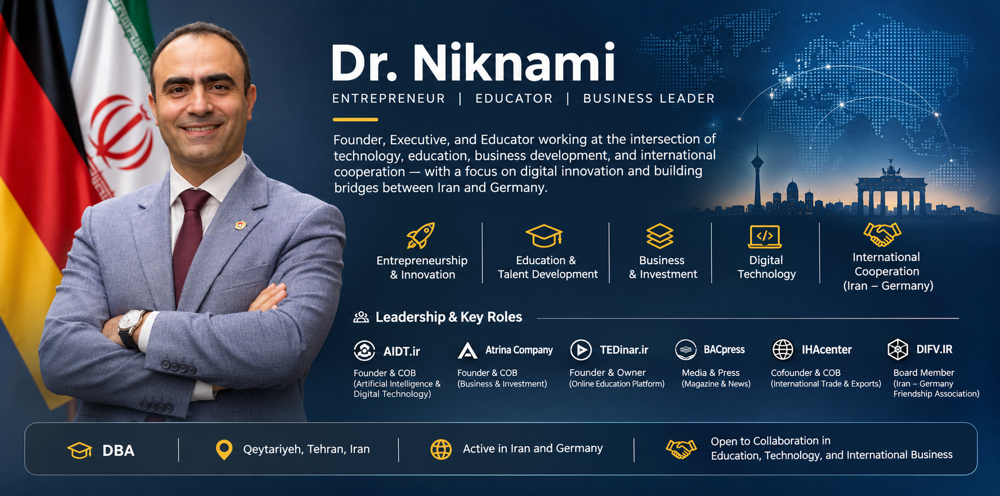

  

---

## 👋 About Me

Welcome to my GitHub profile!

I am **Seifollah Niknami**, an entrepreneur and business leader working across **education, digital technology, business development, media, and international collaboration**. My activities span the development of organizations and initiatives that connect people, ideas, knowledge, and commercial opportunities.

My professional interests include building sustainable organizations, supporting digital transformation, expanding access to learning, strengthening international business relationships, and helping emerging ideas develop into practical ventures.

I believe that **education, innovation, and meaningful partnerships** can create long-term value for businesses and communities.

> **Focus:** Connecting education, entrepreneurship, technology, and international cooperation.

## 🏢 Leadership & Organizations

### Digital Technology & Innovation

**Founder & Chairman of the Board — [AIDT](https://aidt.ir)**  
An initiative associated with digital technology and innovation. My leadership focus includes organizational development, professional collaboration, and supporting conversations around technology-driven progress.

**Founder & President — Digital Technology and National Smart Development Association**  
Involved in advancing dialogue and collaboration related to digital technologies and smart development in Iran.

### Business & Entrepreneurship

**Founder & Chairman of the Board — Atrina Group (`@Atrinacompany`)**  
Working on business leadership, strategic growth, and the development of entrepreneurial activities and partnerships.

### Education & Professional Learning

**Founder & Owner — [TEDinar](https://TEDinar.ir)**  
An online learning platform focused on making educational opportunities and professional knowledge more accessible through digital channels.

### Media & Publishing

**BAC Press (`@BACpress`)**  
Associated with a magazine and media initiative, supporting the communication and exchange of business-related ideas, knowledge, and perspectives.

### International Cooperation

**Co-founder & Chairman of the Board — IHA Center (`@IHAcenter`)**  
Involved in export management, international marketing, and business cooperation with a particular interest in connections between Iran and European markets.

**Treasurer & Vice Chairman of the Board — [Iran–Germany Friendship Association](https://DIFV.IR)**  
Supporting organizational leadership and people-to-people, cultural, and professional connections between Iran and Germany.

## 🎓 Education & Professional Development

- **DBA (Doctor of Business Administration)** — Tehran University *(listed in professional biography; exact institution name and degree details to be confirmed)*
- Ongoing professional interests: strategic management, entrepreneurship, digital business, leadership, and international market development.

## 🌍 Areas of Interest

| Area | Focus |
| --- | --- |
| Entrepreneurship | Building and developing ventures, teams, and partnerships |
| Digital innovation | Exploring technology-enabled business and organizational development |
| Education | Online learning, knowledge sharing, and professional development |
| Business strategy | Leadership, growth, and sustainable organizational development |
| International trade | Export management, cross-border cooperation, and market connections |
| Media & communication | Publishing, business dialogue, and knowledge dissemination |
| Iran–Germany relations | Professional, institutional, and cultural cooperation |

## 🤝 Collaboration

I welcome opportunities to connect with entrepreneurs, educators, researchers, technology professionals, business leaders, and organizations interested in:

- Digital innovation and responsible technology adoption
- Educational initiatives and online learning
- Entrepreneurship and organizational development
- International trade and business partnerships
- Cross-border cooperation between Iran, Germany, and other markets
- Business media, publishing, and professional knowledge exchange

## 🔗 Organizations & Platforms

- 🌐 **AIDT:** [aidt.ir](https://aidt.ir)
- 📚 **TEDinar:** [TEDinar.ir](https://TEDinar.ir)
- 🤝 **Iran–Germany Friendship Association:** [DIFV.IR](https://DIFV.IR)
- 🏢 **Atrina Group:** `@Atrinacompany`
- 📰 **BAC Press:** `@BACpress`
- 🌍 **IHA Center:** `@IHAcenter`

## 📬 Get in Touch

For professional inquiries, collaboration proposals, and partnership discussions, please reach out through the organizations and platforms above or via GitHub.

---

**Building connections between business, education, innovation, and international opportunity.**

*Thank you for visiting my profile.*

